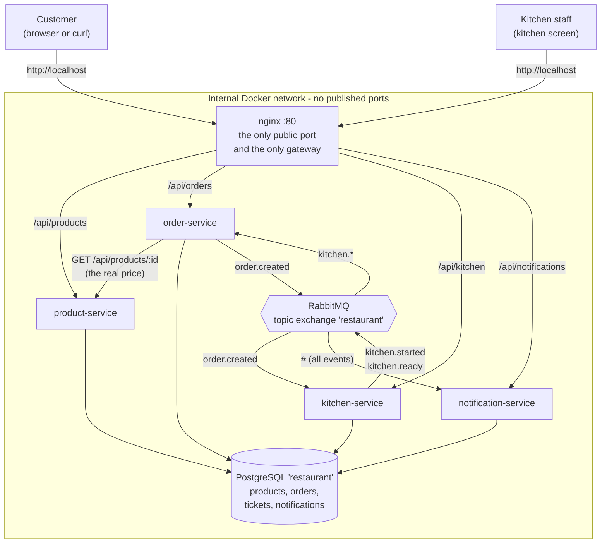

# Architecture and test strategy

This is the longer explanation behind the [README](../README.md): why the
system is built the way it is, and how it is tested.

---

## 1. The system



Only nginx has `ports:` in `docker-compose.yml`. Everything else can only be
reached from inside the Docker network.

---

## 2. Why it looks like this

### One gateway, not two

nginx is the gateway. It sends `/api/products` to product-service,
`/api/orders` to order-service and so on.

An earlier version of this project had an extra `api-gateway` service behind
nginx that only forwarded requests. That was two gateways doing the same job:
one more service to start, one more network hop for every request, and one more
place to change every time a route was added. nginx already does reverse
proxying very well, so the extra service is gone.

The services listen on the same paths that the outside world uses
(`/api/products`, `/api/orders`, ...). That means nginx does not have to rewrite
any urls, which is one of the easiest things to get wrong in an nginx config.

### The kitchen is a real service, not a simulation

`kitchen-service` has its own table (`tickets`) and its own API for the staff.
It does **not** cook with timers. When `order.created` arrives, a ticket appears
on the kitchen screen with status `WAITING`. Then a human presses:

* **Start cooking** → the ticket becomes `COOKING` and `kitchen.started` is published
* **Food is ready** → the ticket becomes `READY` and `kitchen.ready` is published

This is how a real restaurant works, and it also makes the system honest: the
order status the customer sees really comes from what happened in the kitchen.

### When HTTP and when events

| Kind        | Used for                                | Example                                        |
| ----------- | --------------------------------------- | ---------------------------------------------- |
| HTTP (sync) | when we need an answer right now        | order-service asks product-service for a price |
| Events (async) | when we are telling the system what happened | `order.created`, `kitchen.started`, `kitchen.ready` |

order-service does not know that kitchen-service or notification-service exist.
It only says "an order was created". If we later add for example a
`statistics-service`, it just binds a new queue to the same exchange and nothing
in the existing code has to change.

### RabbitMQ settings

* One **topic exchange**, `restaurant`, so consumers can pick what they want:
  kitchen-service takes `order.created`, order-service takes `kitchen.*`, and
  notification-service takes `#` (everything).
* **Durable** exchange, **durable** queues and **persistent** messages, so a
  restart of RabbitMQ does not lose events.
* **Manual ack**: we ack a message only after the handler is finished. If a
  service crashes in the middle, RabbitMQ gives the message to it again.
* `prefetch(1)`: one message at a time, which keeps the order of the events easy
  to follow.

### One database with four tables

There is one PostgreSQL database, but **each table has exactly one owner**:

| Table           | Owner                | Nobody else writes to it |
| --------------- | -------------------- | ------------------------ |
| `products`      | product-service      | ✔                        |
| `orders`        | order-service        | ✔                        |
| `tickets`       | kitchen-service      | ✔                        |
| `notifications` | notification-service | ✔                        |

A real production system would give each service its own database. For a school
project one database is much easier to start and to look into, and because only
one service writes to each table, the code would not have to change if the
databases were split later.

### Layers inside a service

```
index.ts             -> HTTP routes and event handlers (talks to the outside)
<name>-logic.ts      -> rules and calculations, pure functions, no db and no network
<name>.repository.ts -> the data layer, all the SQL for one table
db.ts                -> the connection
```

This was the other big lesson from the earlier version, where routes, SQL and
rules were mixed in one long file. Now:

* the rules can be unit tested without Docker, because they are pure functions,
* if a column changes, only the repository file changes,
* a new person can find things without reading everything.

---

## 3. Test strategy

| Level         | Where             | What it protects                                                  |
| ------------- | ----------------- | ----------------------------------------------------------------- |
| Unit tests    | `tests/unit/`     | The rules: order validation, price calculation, the kitchen status rules, notification texts. |
| End to end    | `tests/e2e/`      | The whole flow through the real system: nginx, four services, RabbitMQ and PostgreSQL. |

**What is worth unit testing?** The parts where a bug is silent. A wrong total
does not crash anything, it just charges the customer the wrong amount, so
`calculateTotal` and `validateOrder` are tested with several cases. The kitchen
rules (`canStartCooking`, `canMarkReady`) are tested because they are the only
thing stopping the staff from skipping a step.

**What is worth an end to end test?** The event chain. Unit tests cannot see
that an event actually reached the right queue. The end to end test places a
real order, waits for the ticket to appear on the kitchen screen, presses start
and ready, and checks that the customer's order really became `READY` and that
three notifications were saved in the database. That is also a check against the
data layer, because everything the test reads back has been through Postgres.

**Error cases are tested too**, not only the happy path: unknown product, empty
order, unknown order id, and the staff trying to mark food ready before they
started cooking (`409`).

**In CI** the unit tests run first because they are fast. Only if they pass does
GitHub Actions start Docker Compose and run the end to end test. If anything
fails, the workflow prints the docker logs, so the error can be read directly in
the Actions tab.

---

## 4. Known limitations and what I would do next

* No authentication. Anyone who reaches port 80 can use the kitchen API. The
  next step would be a login for the staff, so `/api/kitchen` needs a token.
* One database instead of one per service. It is enough here, but it means a
  service could in theory read another service's table.
* The customer polls `GET /api/orders/:id` every two seconds. WebSockets or
  server sent events would be nicer, but polling is easier to test and easy to
  explain.
* Notifications are only written to the database and to the log. A real system
  would send SMS or push.
* `rabbit.ts` is copied into the three services that use events. In a bigger
  project that would be a shared package, but copying it keeps every Dockerfile
  simple and lets the services be deployed on their own.
* Nothing removes old orders or tickets. A cleanup job would be needed if this
  ran for real.
